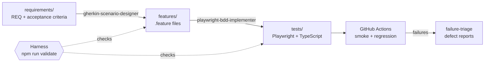

# QA Agent Skills

**Claude Agent Skills for quality engineering: from acceptance criteria to Gherkin to Playwright tests in TypeScript, with a deterministic harness that keeps the AI honest.**

AI agents write tests fast, but speed is only useful if the output is trustworthy. This project packages three Agent Skills that split test work into reviewable stages, and a zero-dependency harness that checks the agent's work at every stage: scenario quality, requirement coverage and traceability from each Gherkin step to the Playwright step that implements it.

  

## How it works



| Stage | Skill | Output | Gate |
| --- | --- | --- | --- |
| 1. Design | [`gherkin-scenario-designer`](.claude/skills/gherkin-scenario-designer/SKILL.md) | Declarative scenarios tagged `@REQ`, `@AC`, `@smoke`/`@regression` | Gherkin rules F1–F9, coverage C1 |
| 2. Automate | [`playwright-bdd-implementer`](.claude/skills/playwright-bdd-implementer/SKILL.md) | Playwright tests with page objects; one `test.step` per Gherkin step | Traceability T1–T3, `tsc`, test run |
| 3. Triage | [`failure-triage`](.claude/skills/failure-triage/SKILL.md) | Failures classified (product, test, environment, flaky) and linked to criteria | Evidence-based classification rules |

## Why a harness

An agent that can edit both the tests and the specification can "pass" by weakening either one. The harness ([rules](docs/harness-rules.md)) removes that option:

- **Coverage:** every acceptance criterion must be proven by at least one scenario.
- **Traceability:** test step titles must match the Gherkin word for word, so the report reads like the spec and drift fails the build.
- **Style:** scenarios describe behavior, not clicks; the harness rejects UI mechanics in steps.
- **Machine-readable:** `reports/validation.json` lets the agent read its own issues and fix them in a loop.

The skills also carry guardrails: never edit a requirement to make a test pass, never weaken an assertion, never mark a failure flaky without a passing re-run.

Example of the harness catching drift:

```text
Features: 2 | Scenarios: 9 | AC coverage: 11/12
✖ [F8] features/login.feature:38 — Imperative UI wording "click" — describe behavior, not mechanics.
✖ [C1] requirements/REQ-002 — AC-002.6 has no scenario covering it.
✖ [T2] features/cart.feature:11 — Steps in tests/cart.spec.ts do not mirror the scenario (missing: "Then the cart count is 2"; not in Gherkin: "Then the cart count is 3").
```

And the triage sheet linking a real failure to its acceptance criterion:

| Scenario | Requirement | Criteria | Failing step | First-pass hint |
| --- | --- | --- | --- | --- |
| Cart lists the selected products and their total | @REQ-002 | @AC-002.3 @AC-002.5 | And the cart total is "$139.49" | Product defect or outdated expectation |

## Quick start

Requirements: Node.js 20+.

```bash
npm install
npx playwright install chromium
npm run check        # harness + typecheck + full Playwright suite
npm run test:smoke   # critical path only
npm run triage       # after a failed run
```

The suite starts the demo app (`demo-app/`, a small login + cart shop) on `http://localhost:4173` automatically.

## Using the skills with Claude Code

Open the repo in Claude Code; the skills in `.claude/skills/` load automatically. Try:

- "Design scenarios for `requirements/REQ-002-cart.md`."
- "Add a requirement for a checkout page, then design and automate it."
- "The pipeline is red. Triage the failures."

## Project structure

```text
.claude/skills/        Agent Skills (SKILL.md + references)
requirements/          REQ-### files with acceptance criteria and test data
features/              Gherkin feature files
tests/                 Playwright specs, page objects, fixtures
scripts/validate.mjs   Harness (zero dependencies)
scripts/triage.mjs     Failure triage sheet from the JSON report
docs/                  Harness rules, defect template
.github/workflows/     CI: harness → smoke + regression matrix
```

## Roadmap

- Skill for API test design (contract and negative cases) from OpenAPI specs.
- k6 performance thresholds as a pipeline gate.
- LLM-output evaluation suite for testing AI features.

## Author

**Ramiro Sian** — Senior SDET · [LinkedIn](https://www.linkedin.com/in/ramiro-antonio-sian-buenafe)

Licensed under MIT.
